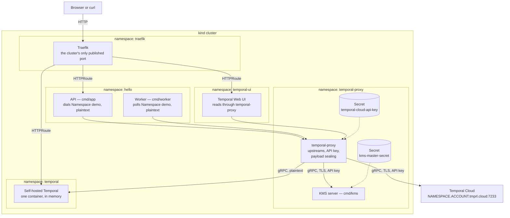

# Temporal Proxy Demo

[![CI][ci-badge]][ci]
[](LICENSE)

Runs Temporal Workers that know nothing about the
[Temporal Service][temporal] they talk to. [temporal-proxy][proxy] sits
in front of them and owns the upstream address, TLS, the API key and
the Namespace names, so the Worker and the API carry no upstream
address, TLS, credential or fully-qualified Namespace of their own.

Connection details are only the first thing it takes over. Payload
encryption is another: temporal-proxy seals payloads — Workflow and
Activity inputs and results among them — before they leave the cluster,
and unseals them on the way back, so the Worker and the API send plain
payloads and hold no key material either. Search Attribute values are
the exception: they stay in the clear, so the Temporal Service can
still index them. All of this happens in temporal-proxy, below whichever
SDK a Worker is written with — this demo uses Go, and nothing about it
is specific to Go.

https://github.com/user-attachments/assets/a35beca7-2195-40da-917f-2e213daa0cd6

The whole demo runs on a local Kubernetes cluster: Traefik publishes the
API, and temporal-proxy is the only workload that knows where Temporal
is.

## Architecture



Solid arrows carry traffic, dotted ones are Secrets a Pod reads. The
Worker's and the API's arrows into temporal-proxy both leave the
application. The Worker long-polls its Task Queue, so its Workflow
Tasks and Activity Tasks arrive over a connection the Worker itself
opened, and nothing ever dials into it. The third arrow into
temporal-proxy is a Web UI's,
[described below](#a-web-ui-that-reads-through-temporal-proxy). Only
Traefik's web entrypoint is published — the two arrows that cross the
cluster boundary are the browser's and temporal-proxy's.

temporal-proxy has two upstreams and forwards to one of them. Temporal
Cloud is the one the demo ships routed at; the self-hosted Service sits
there until the configuration says otherwise, which is
[the scenario below](#routing-at-another-temporal-service).

## Prerequisites

- Docker — builds the image and runs the cluster's node. Podman works
  too: run `make` with `CONTAINER_TOOL=podman`. `kind` picks Podman up
  by itself, unless a `docker` CLI is also on `PATH`; then set
  `KIND_EXPERIMENTAL_PROVIDER=podman` as well
- [kind][kind] — the local Kubernetes cluster, a single node
- `kubectl` and [Helm][helm] 3.16+ — Traefik, cert-manager and
  temporal-proxy all come from their upstream charts, each pinned to an
  explicit version
- Go 1.27 or later
- A Temporal Cloud Namespace that accepts API keys only, and the API key
  of a service account scoped to it, with Write

The image is built locally and loaded straight into the cluster's node,
so there is no registry and nothing to push.

### Creating the Namespace and the API key

Temporal Cloud authenticates temporal-proxy with an API key, so the
demo needs a Namespace that accepts API keys and nothing else. Pick API
keys as the authentication method when creating it in the Cloud UI, or
create it with [`tcld`][tcld], which talks to Cloud, so authenticate
first:

```bash
tcld login
tcld namespace create \
  --namespace "quickstart" \
  --region "aws-us-east-1" \
  --retention-days 1 \
  --auth-method api_key
```

A Namespace that allows both API keys and mTLS will not do. Its own
endpoint, `NAMESPACE.ACCOUNT.tmprl.cloud:7233`, refuses an API key and
demands a client certificate. The regional endpoint accepts the key, but
it finds the Namespace in a `temporal-namespace` request header, and the
Web UI that reads through temporal-proxy
([below](#a-web-ui-that-reads-through-temporal-proxy)) never sends one.

Then create the key's owner, a service account scoped to that one
Namespace, and the key itself:

```bash
tcld service-account create-scoped \
  --name "temporal-proxy-demo" \
  --namespace-permission "quickstart.a1b2c=Write"
tcld apikey create \
  --name "temporal-proxy-demo" \
  --duration 90d \
  --service-account-id "<service account id>"
```

`tcld service-account list` shows the service account's id, and
`tcld apikey create` prints the key's secret once. In the Cloud UI, the
Namespace page's Generate API Key button also creates a scoped service
account, but with Admin on the Namespace; Write is enough.

Write covers what the Worker and the API need, and the Read the Web UI
needs: all three go through temporal-proxy, so they share its one key.
The scope keeps that key from reaching the rest of the account. A user's
key would reach every Namespace the user can see, and the standalone
Web UI would list them all. See [API keys][api-keys] and
[service accounts][service-accounts] for the Cloud side.

## Quick start

Copy the environment template and fill in the three Temporal Cloud
values — the short Namespace name and the account id, the two halves of
a fully-qualified Cloud Namespace (`quickstart.a1b2c` is `quickstart`
plus `a1b2c`), and the API key — then generate the payload key's master
secret. `.env` is git-ignored, so none of these values reaches version
control:

```bash
cp .env.example .env
echo "KMS_MASTER_SECRET=$(openssl rand -base64 32)" >> .env
```

Then bring the demo up and trigger a Workflow:

```bash
make app-up
make demo
```

```json
{"greeting":"Hello, John Doe!","workflowId":"hello-x4t7…","runId":"01a0…"}
```

`make app-up` creates the cluster, installs everything in it and waits
for the rollout. The answer takes about two seconds — the Activity
sleeps, so there is time to watch the Execution in the Cloud Web UI.
`make endpoints` prints the addresses, and `make demo NAME=Alex` greets
someone else.

`make demo` is not the only way in. The API also serves a page at that
same published address, the one `make endpoints` prints: one button
starts an Execution, and the request is drawn travelling through the
stack and back while it runs, so a Workflow is watched from a browser
rather than read off a JSON line. Both go through the same endpoint.

On a freshly created cluster, Traefik can take a couple of seconds to
pick up the API's new Pod — it applies cluster changes at most once
every two seconds — so the very first `make demo` can answer `503`. Run
it again.

Run `make` to list every target. `make app-down` removes the Worker and
the API and leaves everything else standing, so `make app-up` puts the
demo back without recreating the cluster; `make cluster-down` deletes
everything.

## What runs where

| Namespace        | What it holds                                          |
| ---------------- | ------------------------------------------------------ |
| `traefik`        | Traefik and its Gateway, the cluster's only port       |
| `temporal-proxy` | temporal-proxy and the KMS server, plus what they read |
| `temporal`       | The self-hosted Temporal Service, the second upstream  |
| `hello`          | The Worker and the API, with Service and route         |
| `temporal-ui`    | The Web UI that reads through temporal-proxy           |

`make cluster-up` also creates a `cert-manager` and a
`secretgen-controller` namespace, for the two controllers that issue the
KMS server's certificate and generate its bearer token.

The workloads come from Kustomize manifests — the Worker and the API
from `k8s/app`, the KMS server from `k8s/kms`, the self-hosted Temporal
Service from `k8s/temporal` and the Web UI from `k8s/ui` — and the three
charts take their values from `k8s/charts/`.

## How the API key travels

The API key never appears in a manifest, nor in the ConfigMap the chart
renders. `make apply` reads it from `.env` and builds the Secret the
chart references:

```text
TEMPORAL_CLOUD_API_KEY in .env
  → Secret temporal-cloud-api-key
  → the upstream's credentials.static.apiKey in k8s/charts/temporal-proxy.yaml
  → an environment variable the chart adds, TP_UPSTREAM_CLOUD_API_KEY
  → ${TP_UPSTREAM_CLOUD_API_KEY} in the rendered configuration
```

temporal-proxy expands that reference at startup and sends the key with
every request to Cloud, over TLS. `make apply` restarts temporal-proxy,
so rotating the key is editing `.env` and running `make apply`.

What the chart references is an ordinary Kubernetes Secret, and nothing
assumes where that Secret came from. `make` fills it here so the demo
stays self-contained, but whatever else populates a Secret works just
as well — the Vault Secrets Operator, the External Secrets Operator
syncing from a cloud secret manager, a sealed-secret controller — and
the `secretKeyRef` under `apiKey` is the only place that has to agree
with it.

## How the payload key travels

temporal-proxy generates a data encryption key, seals payloads with it,
and asks the KMS server to wrap that key:

```text
KMS_MASTER_SECRET in .env
  → Secret kms-master-secret
  → the KMS server, which derives one 256-bit key per Namespace
  → wraps each data encryption key temporal-proxy sends it, with AES-256-GCM
  → the wrapped key travels inside the sealed payload
```

temporal-proxy reuses a data key for an hour and caches the keys it has
unwrapped, so it calls the KMS server for a new key or one it has not
opened yet, not once per payload. It calls over TLS, trusting the
self-signed certificate cert-manager issues for the KMS server, and
presents a bearer token secretgen-controller generates in the cluster:
neither appears in any file of this repository.

The KMS server derives its key from the short Namespace name the
application asked for — `demo` — never the fully-qualified Cloud name.

Turning encryption off is one flag, `encryption.enabled`, plus
`make apply`. Payloads sealed earlier stay readable, which is why the
flag rather than the whole block is what turns encryption off.

## Routing at another Temporal Service

Temporal Cloud is not the only upstream in the cluster. A self-hosted
Temporal Service runs beside it, in the `temporal` namespace: one
container, everything in memory, nothing persisted, with the `demo`
Namespace created at startup. It is there to answer a question the
Worker has no way to ask — which Temporal Service is serving it.

Both upstreams are declared in `k8s/charts/temporal-proxy.yaml`, and
`routing.default` alone picks which one serves requests, which makes
switching a single word:

```yaml
config:
  routing:
    default: cloud   # write `selfhosted` here instead
  upstreams:
    - name: cloud
      hostPort: ${TEMPORAL_CLOUD_NAMESPACE}.${TEMPORAL_ACCOUNT}.tmprl.cloud:7233
      # ... the API key, the Namespace rewrite
    - name: selfhosted
      hostPort: temporal.temporal:7233
      insecure: true
```

```bash
make apply
make demo
```

Both upstreams have to be up whichever one is selected: temporal-proxy
dials every upstream with a fixed address at startup, and refuses to
start if one is unreachable. That is also why the Temporal Cloud values
and the API key stay required while the self-hosted Service serves: the
Cloud upstream is still declared, so its address must connect, and its
configuration refuses an empty API key.

`routing.system` is absent on purpose. Left unset, it hands the
requests that carry no Namespace — the `GetSystemInfo` a Client sends on
connect, among others — to `routing.default` as well, so there is only
ever one name to change.

The second upstream is three lines. `insecure: true` stands where a
`tls` block would, because the endpoint serves plaintext inside the
cluster, and an upstream that does not state its transport is dialled
over TLS, verified against the system roots — which is also why the
Cloud upstream carries no `tls` block. No `namespaces.rules`, because
that Service registers the Namespace under `demo` — the very name the
application asks for — so there is nothing to rewrite, where Cloud
knows it as `NAMESPACE.ACCOUNT`.

Nothing else moves. The image is not rebuilt, the Worker and the API are
neither restarted nor reconfigured, and they still hold the same two
variables: `temporal-proxy.temporal-proxy:7233` and `demo`. The page
they serve is unchanged too, because it never named an upstream in the
first place.

`make endpoints` prints the self-hosted Web UI, published on the same
single Traefik port as the demo. Run `make demo` on either side of the
switch and the two Executions land in different Temporal Services — the
first in the Cloud Namespace, the second in this one.

Payload encryption is not part of the switch. temporal-proxy seals
payloads whichever upstream it forwards to, so the self-hosted Web UI
shows them sealed exactly as the Cloud one does: the Temporal Service on
the far end never holds the key.

Living in memory is what makes the self-hosted Service disposable, and
why Temporal Cloud is the upstream the demo ships routed at. Write
`cloud` back and run `make apply` to return.

One upstream at a time is only the simplest case: `routing.rules`
matches on the Namespace a request asks for, so a single temporal-proxy
can serve `demo` from the self-hosted Service and another application's
Namespace from Cloud, with neither application aware of the split.

temporal-proxy's own [documentation][proxy-docs] covers everything it does
beyond what this demo shows.

## A Web UI that reads through temporal-proxy

The cluster runs a third Web UI, a standalone one in the `temporal-ui`
namespace, at `http://temporal-webui.127-0-0-1.nip.io:<port>` —
`make endpoints` prints it with this worktree's port. Its frontend is
temporal-proxy, dialled exactly as the Worker and the API dial it, so it
reads whichever upstream `routing.default` selects, and follows the
switch above with nothing of its own to change.

It shows payloads in cleartext. temporal-proxy opens every payload on
its way back, for this UI as for the Worker, so an Execution the Cloud
and self-hosted Web UIs show sealed reads here in the clear.

On a Cloud upstream, a few of the calls the UI makes — `ListNamespaces`
and `ListSearchAttributes` among them — are not answered by a Namespace
endpoint. temporal-proxy translates them onto Cloud's control plane, the
[Cloud Ops API][cloud-ops], which accepts an API key and never a
certificate. It reuses the Cloud upstream's own key there, so the
Namespace picker and the search attribute lists work with nothing more
configured. The Namespaces page lists `demo` alone, because the key's
service account is scoped to that one Namespace.

The UI is read-only: its own server refuses every call that would change
state.

Nothing in front of this UI asks who is reading, and everything it shows
is decrypted. Kind would publish Traefik's port on every interface, so
the cluster config binds it to `127.0.0.1`: keep it so.

## What the application does not carry

The Worker and the API each get the same two environment variables, and
neither describes an upstream:

| Variable             | Value                                |
| -------------------- | ------------------------------------ |
| `TEMPORAL_ADDRESS`   | `temporal-proxy.temporal-proxy:7233` |
| `TEMPORAL_NAMESPACE` | `demo`                               |

Those two are a cluster-local address, dialled in plaintext, and a short
Namespace name. Nothing else is needed because everything else lives in
temporal-proxy's configuration: the Cloud endpoint, the API key, and
the rewrite from `demo` to the fully-qualified Cloud Namespace.
`TEMPORAL_NAMESPACE` says which Namespace the application asks for, not
which upstream serves it — picking an upstream is not something the
application can do.

The short name is `demo` rather than `default` because one
temporal-proxy fronts several applications, so the name each one asks
for has to identify it. Both variables also have fallbacks in the code —
`localhost:7233` and `default`, what a `temporal server start-dev`
serves — so the binaries run unchanged outside the cluster.

## License

This project is licensed under the Apache-2.0 License — see
[LICENSE](LICENSE) for details.

temporal-proxy itself is a separate project, licensed under MIT.

[ci]: https://github.com/alexandreroman/temporal-proxy-demo/actions/workflows/ci.yaml
[ci-badge]: https://github.com/alexandreroman/temporal-proxy-demo/actions/workflows/ci.yaml/badge.svg
[temporal]: https://temporal.io
[proxy]: https://github.com/temporalio/temporal-proxy
[proxy-docs]: https://docs.temporal.io/production-deployment/temporal-proxy
[kind]: https://kind.sigs.k8s.io
[helm]: https://helm.sh
[api-keys]: https://docs.temporal.io/cloud/api-keys
[service-accounts]: https://docs.temporal.io/cloud/service-accounts
[cloud-ops]: https://docs.temporal.io/ops
[tcld]: https://docs.temporal.io/cloud/tcld
